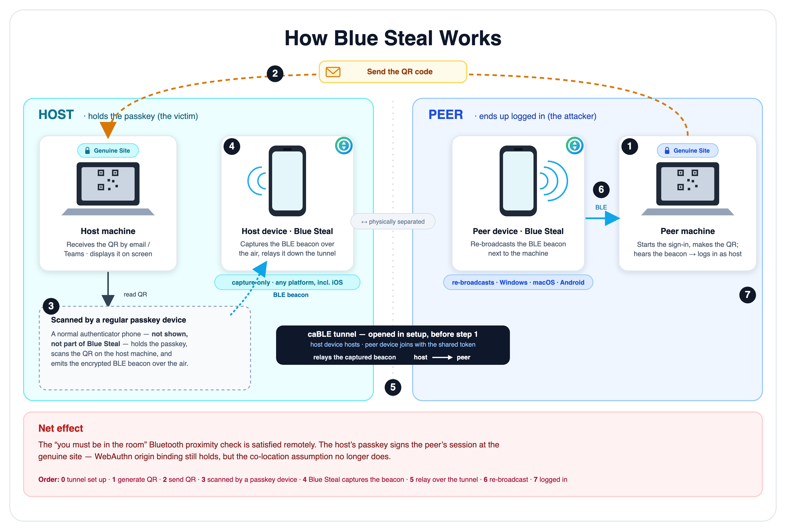
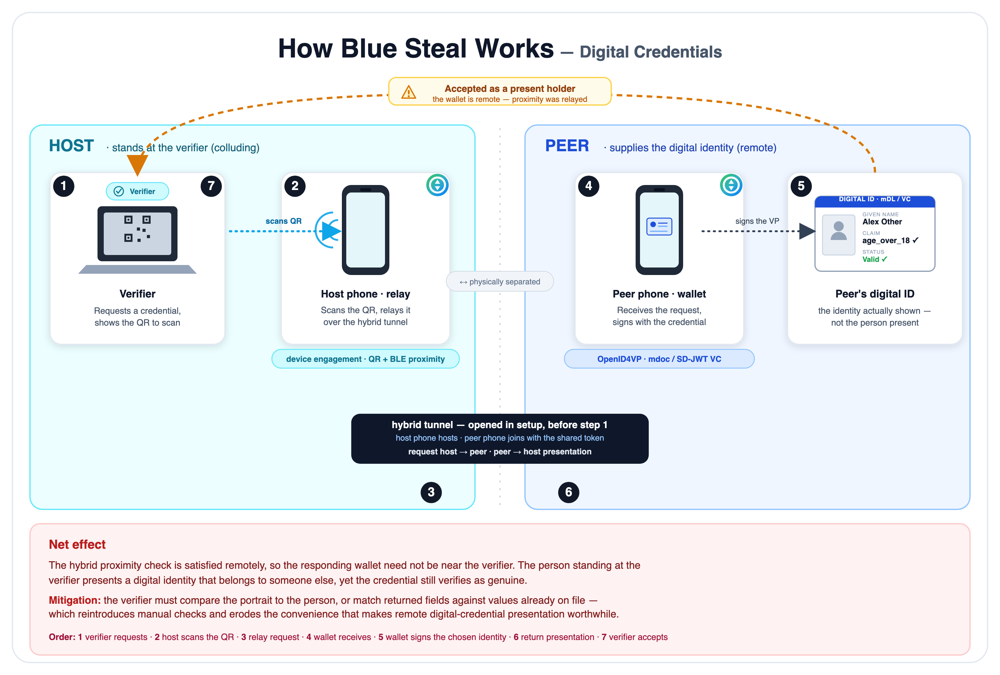

# Relaying the proximity check in FIDO hybrid (caBLE) transport

*Disclosure report and proof-of-concept analysis*

| | |
|---|---|
| **Affected mechanism** | FIDO CTAP 2.2 hybrid transport (formerly "caBLE" / cloud-assisted BLE), and the equivalent cross-device flows being reused for digital-credential presentation |
| **Class** | Proximity-check bypass / authentication relay. Not a break of FIDO cryptography or origin binding. |
| **Proof of concept** | Blue Steal, a cross-platform (Windows / macOS / iOS / Android) BLE advertisement capture-and-rebroadcast tool |
| **Disclosure status** | Responsible disclosure (see [Disclosure](#9-responsible-disclosure)) |

---

## 1. Summary

FIDO2/WebAuthn passkeys are phishing-resistant because every assertion is
cryptographically bound to the relying party's origin: the authenticator signs
over the RP ID, the client supplies the true origin, and a look-alike domain
cannot obtain a usable signature. That property is sound and is not what this
report concerns.

Cross-device sign-in ("use your phone to log in on this computer") relaxes one
assumption that origin binding does not address: that the phone acting as the
authenticator is physically next to the computer requesting authentication. The
hybrid transport re-establishes that assumption with a Bluetooth Low Energy
(BLE) proximity check. The phone emits a BLE advertisement, and the computer
must receive it before sign-in can complete.

This report sets out that the BLE proximity check is an assumption, not a
guarantee. The advertisement is an unauthenticated, location-agnostic sequence
of bytes; receiving it does not establish that the phone is nearby. The Blue
Steal proof of concept demonstrates this by capturing a genuine caBLE
advertisement on one device and re-broadcasting it on another in a different
location. A second, related finding is that the tunnel servers FIDO uses to
carry the CTAP/CBOR payload can also carry the advertisement between the two
locations, so the relay requires no infrastructure of its own.

The result is a man-in-the-middle relay. A control intended to mean "the phone
is in the room" instead means "the phone is within Bluetooth range of a device
the attacker controls," which can be arranged remotely.

---

## 2. Background: how caBLE / hybrid transport works

The hybrid transport is defined in the Client to Authenticator Protocol (CTAP)
2.2, §11.5 "Hybrid transports" (with §11.5.1 QR-initiated and §11.5.2
state-assisted transactions) [[1]]. It lets a phone act as a roaming
authenticator for a sign-in happening on a different device, such as a laptop
browser or a kiosk. For a QR-initiated transaction the flow is:

1. **QR code.** The client (browser or platform) displays a `FIDO:/` QR code. It
   encodes a CBOR map containing a compressed P-256 public key (33 bytes) and a
   shared secret, plus the set of tunnel-server domains the client knows
   [[1]][[2]].
2. **Scan and BLE advertisement.** The phone scans the QR code, derives keys
   from the secret, and begins broadcasting a short (about 20-byte) encrypted BLE
   advertisement under the FIDO service-data UUID `0xFFF9` (Google's variant uses
   `0xFDE2` / manufacturer data). The advertisement carries a nonce and the
   routing information the client needs: which tunnel server to use and the
   server-assigned routing identifier [[2]][[3]].
3. **Tunnel.** The client decrypts the advertisement, then opens a WebSocket to
   the indicated tunnel server. Well-known examples are Google's
   `wss://cable.ua5v.com` and Apple's `wss://cable.auth.com`, with a hashed-domain
   scheme reserved for future servers [[1]][[3]]. The tunnel server is a blind
   1:1 byte bridge and cannot see inside the encrypted payload.
4. **Noise handshake and CTAP2.** Over the tunnel, the two endpoints run a Noise
   handshake that proves the client holds the QR keys and received the BLE
   advertisement. CTAP2 (CBOR) then runs end-to-end over this encrypted channel,
   as it would over USB or NFC [[1]][[3]].

The design point central to this report is that Bluetooth carries no
authentication data. The cross-device design is described as using BLE "only as
a proximity check, not a data channel; all authentication data flows over an
encrypted internet tunnel" [[2]]. FIDO and vendor guidance state that the flow
"uses Bluetooth Low Energy (BLE) to verify physical proximity, but does not
depend on Bluetooth security properties for the actual security of the sign-in"
[[2]].

### What functionality this enables

- Signing into a desktop or web session with a passkey that lives only on a
  phone.
- Using one device's biometric / secure element as an authenticator for a nearby
  client, without provisioning the credential onto that client.
- The same cross-device, proximity-assisted flow is increasingly reused to
  present verifiable digital credentials (mobile driving licences, age or
  identity attestations) to an in-person or on-screen verifier.

---

## 3. What "phishing-resistant" covers, and what backs it

Two distinct guarantees are often combined under the term "phishing-resistant":

- **Origin binding (cryptographic).** WebAuthn signs `clientDataJSON` containing
  the real origin and binds the assertion to the RP ID; the browser will not
  invoke a credential for a mismatched origin. A look-alike phishing domain
  cannot harvest a reusable credential [[4]][[5]]. This is the basis of FIDO
  phishing resistance and it is intact.
- **Co-location (heuristic).** For cross-device sign-in, origin binding says
  nothing about where the phone is. The control separating "approve this sign-in
  for the genuine RP" from "approve it for an attacker's remote session at the
  genuine RP" is the BLE proximity check: the assumption that if the client heard
  the advertisement, the phone is local [[2]][[3]].

The FIDO community has questioned whether the BLE message provides meaningful
assurance [[6]], and practitioners have noted there is no way for a relying party
to detect whether the hybrid flow was used, nor a supported mechanism to block it
[[7]]. This report concerns the second guarantee.

---

## 4. The issue: proximity is assumed, not proven

### 4.1 The advertisement is not bound to a device or a location

The BLE advertisement is a self-contained, replayable byte string. It is
encrypted to the QR secret, so an unrelated eavesdropper cannot read it, but it
is not bound to the emitting radio, to a physical location, or to a round-trip
with the client. Nothing in the advertisement, and nothing the client does with
it, distinguishes an advertisement received directly over the air from a phone
30 cm away from one captured elsewhere and re-emitted by a radio next to the
client. The client treats receipt of the advertisement as proof of presence.
That inference does not hold.

### 4.2 What Blue Steal shows

Blue Steal is a cross-platform tool that performs two operations on a genuine
caBLE advertisement:

1. **Capture.** It scans for live caBLE advertisements (`0xFFF9` / `0xFDE2`)
   emitted by a real authenticator during a hybrid sign-in.
2. **Re-broadcast.** It relays the captured advertisement to a paired device
   elsewhere, which re-emits it byte-for-byte over its own BLE radio.

A browser next to the second device receives the advertisement and concludes the
authenticator phone is nearby, when the phone is wherever the first device is.
The proximity control is reduced to "within Bluetooth range of a Blue Steal
node," and those nodes can be in any location. We have reproduced relayed
sessions across separate machines and platforms. Re-broadcast fidelity is
platform-dependent: Windows and Android re-emit raw service-data faithfully,
macOS uses a lossy UUID encoding, and iOS can capture only.

### 4.3 Related finding: the tunnel server can serve as the side channel

A relay normally needs its own out-of-band link to move the advertisement from
the victim's vicinity to the attacker's. Blue Steal shows this link is already
provided by FIDO's own infrastructure. The public tunnel servers
(`cable.ua5v.com`, `cable.auth.com`, and the hashed-domain family) are generic,
blind, NAT-traversing, TLS-terminated 1:1 byte bridges. Two endpoints that share
a short code can rendezvous on the same tunnel slot and exchange arbitrary framed
bytes, including the captured advertisements. The mechanism intended to carry the
CTAP/CBOR payload between devices can also carry the proximity beacon between
devices. No attacker-operated server is required.

### 4.4 What is not affected

To be precise, and to avoid the over-claiming that has accompanied some related
reports (one widely cited "FIDO bypass" was later clarified as not a
cryptographic break [[8]][[9]]): this is not a break of FIDO signatures, key
storage, or origin binding. The relayed credential authenticates to the genuine
relying party with a valid, correctly origin-bound assertion. The control that is
defeated is the proximity assumption layered on top, which is the only thing the
cross-device flow relies on to prevent a remote relay.

---

## 5. Proof of concept: Blue Steal as a man-in-the-middle relay

*Figure 1. Relay overview. The host node, near the victim, captures the phone's
BLE advertisement; the peer node, near the attacker's machine, re-broadcasts it;
the caBLE tunnel opened in setup carries the advertisement between the two.*

Blue Steal operates as a man-in-the-middle on the proximity channel. One node
sits in Bluetooth range of the victim's phone and captures its advertisement; a
second node sits next to the attacker's client and re-broadcasts it; the FIDO
tunnel carries the bytes between them. The attacker's client then satisfies the
BLE proximity check using a phone it is not near. Two abuse scenarios follow.

### Scenario A: Relaying a passkey sign-in

1. The attacker begins a genuine sign-in at the real relying party (for example
   the victim's bank or IdP) on the attacker's own machine, choosing "sign in
   with a phone." The RP/client produces a legitimate hybrid QR code.
2. The attacker delivers that QR code to the victim under a pretext, such as
   "scan to verify your account" or "scan to claim your funds" (see §6 for why
   this works).
3. The victim scans it with their phone. The phone, treating this as a normal
   cross-device login, emits the caBLE advertisement and stands ready to
   authenticate.
4. A Blue Steal node near the victim captures the advertisement and relays it
   over the FIDO tunnel to a Blue Steal node beside the attacker's machine, which
   re-broadcasts it.
5. The attacker's browser receives the advertisement, the proximity check passes,
   the tunnel completes, and the victim's phone signs the assertion for the
   attacker's session at the genuine RP. The attacker is then signed in as the
   victim. Origin binding does not prevent this, because the origin is the
   genuine RP.

The control that would otherwise stop step 5 is proximity, and that is the
control Blue Steal relays.

### Scenario B: Relaying a verifiable digital credential

*Figure 2. Digital-credential variant. The host node stands at the verifier and
relays the presentation request over the hybrid tunnel to a remote wallet, which
supplies the credential while appearing co-located with the verifier.*

As the same proximity-assisted cross-device flow is adopted for digital
credential presentation (mDL, age or identity verification), a verifier that asks
the holder to present a credential assumes the holder is physically present: in
the room, at the counter, or on the same machine. By relaying the proximity
beacon, a holder, or an attacker using a relayed advertisement, can present a
credential to a verifier they are not co-located with. For example, a remote
person satisfies an in-person age or identity check, or a credential is presented
to a verifier in another location while appearing local. The "presenter is here"
assumption fails for the same reason as Scenario A.

---

## 6. Why this is difficult to mitigate

- **The transport cannot simply be blocked.** The advertisement relay uses the
  same tunnel servers and the same BLE advertisements that legitimate
  synced-passkey sign-ins depend on. Blocking the tunnel domains or the `0xFFF9`
  advertisements breaks real cross-device authentication. Relying parties also
  currently have no signal that a hybrid flow, let alone a relayed one, was used
  [[7]].
- **The pretext is plausible.** Users are accustomed to scanning QR codes, and a
  campaign can frame the QR code as routine or urgent ("scan to log in and claim
  your funds," "scan to confirm your identity"). The victim's device shows a
  legitimate prompt for the genuine RP, because it is one.
- **Related activity already exists.** Cross-device sign-in abuse has been
  observed in the wild (for example the "PoisonSeed" QR-phishing campaigns) and
  in independent PoCs that relay BLE advertisements via deployed beacons
  [[7]][[8]][[9]]. Blue Steal adds a cross-platform demonstration that the BLE
  proximity layer itself is relayable, and that the FIDO tunnel can act as the
  relay's carrier.

---

## 7. Recommendations

**For the ecosystem / specification (longer-term, structural):**

- **Bind the session to the Bluetooth link, not only to a one-shot beacon.** Make
  proximity load-bearing: carry part of the exchange directly over the BLE
  channel, and/or apply distance-bounding or round-trip-time constraints so a
  relayed advertisement cannot substitute for a co-located radio. This would
  align the cross-device flow's phishing-resistance claim with its actual
  behaviour.
- **Prefer device-bound passkeys for high-assurance contexts.** Where remote
  relay is unacceptable, device-bound (non-syncable, hardware-attested)
  credentials and platform attestation raise the bar beyond a proximity
  heuristic.
- **Give relying parties a signal.** Provide a supported, detectable indication
  that a hybrid / cross-device flow was used, with policy hooks to disallow it
  for sensitive operations. Today there is neither [[7]].

**For relying parties (near-term, compensating):**

- Allow administrators to disable cross-device / hybrid sign-in for high-value
  accounts and step-up operations, and require a local authenticator there.
- Add behavioural and telemetry signals (geographic and timing anomalies between
  the session origin and other context) and step-up challenges for cross-device
  sign-ins.

**For users:**

- Treat an unexpected "scan this QR code to sign in" request like an unexpected
  password prompt. Do not scan QR codes sent by message, email, or a third party
  to log in, verify, or claim anything.

---

## 8. Affected parties and scope

This is a property of the cross-device flow, not of any single vendor's
implementation. It applies wherever the FIDO hybrid transport, or an equivalent
proximity-assisted cross-device credential flow, treats receipt of a BLE
advertisement as proof of co-location. The PoC interoperates with the public
tunnel servers operated by major platform vendors.

---

## 9. Responsible disclosure

This document and the Blue Steal proof of concept are intended for defensive
research and to support hardening of the cross-device flow. The PoC is a relay
and observation tool. It does not break FIDO cryptography, and it carries no
exploit against any relying party beyond demonstrating the proximity bypass.

Findings should be shared with the FIDO Alliance and the relevant platform
vendors (tunnel-server operators) ahead of any public discussion, with a standard
remediation window. (Timeline to be completed: report date, vendor
acknowledgement, agreed disclosure date.)

---

## 10. References

[1]: https://fidoalliance.org/specs/fido-v2.2-rd-20230321/fido-client-to-authenticator-protocol-v2.2-rd-20230321.html
[2]: https://www.corbado.com/blog/webauthn-passkey-qr-code
[3]: https://www.imperialviolet.org/2023/07/23/u2f-to-passkeys.html
[4]: https://fidoalliance.org/passkeys/
[5]: https://workos.com/blog/cryptographic-origin-binding
[6]: https://groups.google.com/a/fidoalliance.org/g/fido-dev/c/A71mU8riKvM
[7]: https://denniskniep.github.io/posts/14-fido-cross-device-phishing/
[8]: https://thehackernews.com/2025/07/poisonseed-hackers-bypass-fido-keys.html
[9]: https://www.scworld.com/news/phishing-attack-abuses-qr-codes-to-bypass-fido-keys

1. FIDO Alliance. *Client to Authenticator Protocol (CTAP) 2.2*, §11.5 Hybrid transports. <https://fidoalliance.org/specs/fido-v2.2-rd-20230321/fido-client-to-authenticator-protocol-v2.2-rd-20230321.html>
2. Corbado. *WebAuthn Passkey QR Codes & Bluetooth: Hybrid Transport* (BLE as proximity-only; data over the internet tunnel). <https://www.corbado.com/blog/webauthn-passkey-qr-code>
3. A. Langley. *From U2F to passkeys* (caBLE/hybrid internals, tunnel servers, BLE advert). <https://www.imperialviolet.org/2023/07/23/u2f-to-passkeys.html>
4. FIDO Alliance. *Passkeys* (phishing-resistance claims). <https://fidoalliance.org/passkeys/>
5. WorkOS. *Cryptographic origin binding* (why origin binding defeats look-alike phishing). <https://workos.com/blog/cryptographic-origin-binding>
6. FIDO-dev mailing list. *Is the BLE advertisement message really necessary?* <https://groups.google.com/a/fidoalliance.org/g/fido-dev/c/A71mU8riKvM>
7. D. Kniep. *FIDO Cross Device Phishing* (BLE-advert relay via beacons; no RP detection/blocking of hybrid). <https://denniskniep.github.io/posts/14-fido-cross-device-phishing/>
8. The Hacker News. *PoisonSeed Hackers Bypass FIDO Keys Using QR Phishing and Cross-Device Sign-In Abuse*. <https://thehackernews.com/2025/07/poisonseed-hackers-bypass-fido-keys.html>
9. SC Media. Coverage and the subsequent "not a FIDO bypass" clarification. <https://www.scworld.com/news/phishing-attack-abuses-qr-codes-to-bypass-fido-keys>
